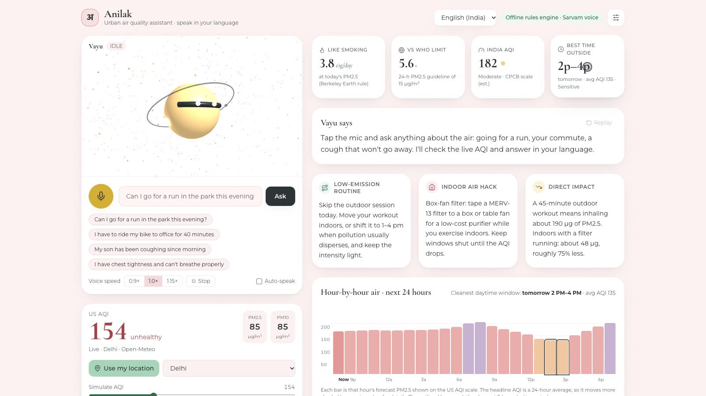
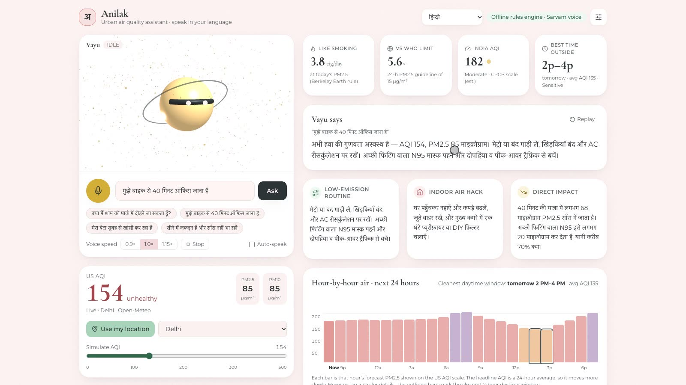
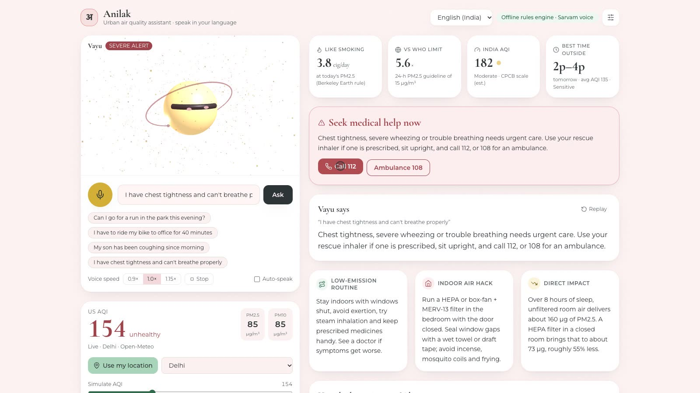
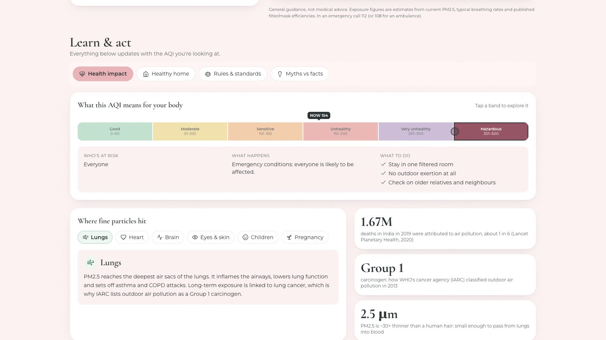
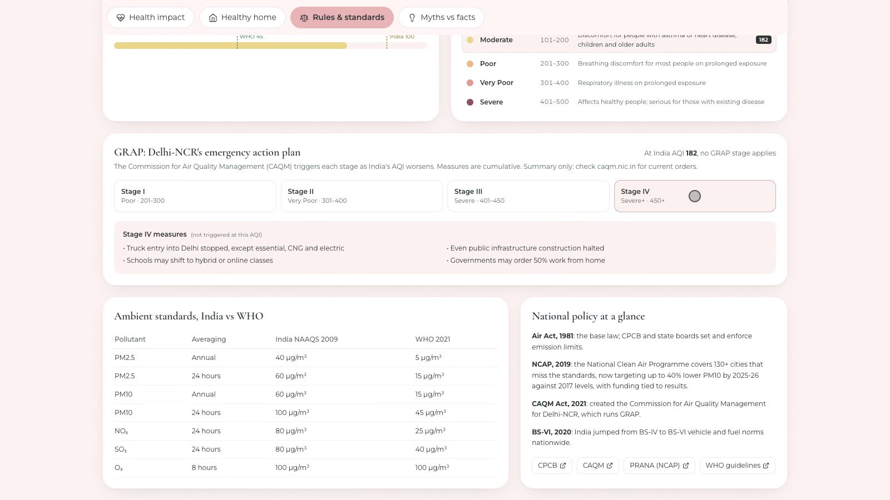

# Anilak

[](https://github.com/supermanyu90/anilak/actions/workflows/ci.yml)
[](https://anilak.vercel.app)

**Voice-first, multilingual air quality assistant for Indian cities.** Ask out loud, in English, Hindi, Marathi, Bengali or Tamil, whether it's safe to go for a run, take the scooter to work, or let the kids play outside. Anilak checks the live air and answers in your language with three concrete actions.

*Anilak* (अनिलक) comes from *anila*, Sanskrit for air or wind. Its guide is **Vayu**, a 3D mascot named after the wind god.

**Live app:** https://anilak.vercel.app · **Demo video (2:26):** [anilak-demo release v1.0](https://github.com/supermanyu90/anilak-demo/releases/tag/v1.0) (private repo)



## Features

| | |
| --- | --- |
| **Live air, at a glance** | Current US AQI, PM2.5 and PM10 from [Open-Meteo](https://open-meteo.com/en/docs/air-quality-api), translated into plain terms: cigarettes per day, how far over the WHO limit, India's CPCB AQI and the best time to step out. Use your location, a city preset or the AQI simulator. |
| **Ask anything** | Type or speak a question. The intent engine sorts it into outdoor activity, health symptom or commute, spots vulnerable people (children, older adults, pregnancy, asthma) and returns a **low-emission routine**, an **indoor air hack**, and a **direct impact** figure: the PM2.5 you'd inhale versus with the mitigation. |
| **Answers in your language** | English, हिन्दी, मराठी, বাংলা and தமிழ். Voice input uses Sarvam AI `saaras:v4` with language auto-detect, and spoken replies use `bulbul:v3`. Without Sarvam it falls back to the browser's Web Speech API. |
| **Safety first** | Chest tightness, trouble breathing and similar phrases in any of the five languages skip everything else and show emergency guidance with one-tap **112** and **108** calls. |
| **Plan around the air** | An hour-by-hour PM2.5 forecast for the next 24 hours, with the cleanest two-hour daytime window highlighted. |
| **Vayu reacts** | A Three.js mascot whose smog cloud thickens and changes colour with the AQI. A shield appears above AQI 250, and Vayu shows listening, thinking, speaking and severe-alert states. |
| **Learn & act** | Health impact by AQI band and by organ; a healthy-home checklist with a live score and a purifier (CADR) size calculator; your air against India's NAAQS and the WHO's guidelines; the CPCB AQI scale and Delhi-NCR's GRAP stages; myth-vs-fact flip cards. |

<table>
  <tr>
    <td><br><sub>Answers in Hindi, Marathi, Bengali, Tamil or English</sub></td>
    <td><br><sub>Acute symptoms trigger the emergency guardrail</sub></td>
  </tr>
  <tr>
    <td><br><sub>What each AQI band means for your body</sub></td>
    <td><br><sub>GRAP stages and India vs WHO standards</sub></td>
  </tr>
</table>

## How it works

```
 voice ──► Sarvam saaras:v4 (auto-detect) ─┐
 typed ────────────────────────────────────┤
                                           ▼
                           safety guardrail (acute symptoms?) ──yes──► 112 / 108 alert
                                           │ no
                                           ▼
          live air (Open-Meteo) ──► intent engine (offline rules, or Gemini if a key is set)
                                           │
                                           ▼
             3 action cards + spoken reply (Sarvam bulbul:v3 or browser voice) + Vayu state
```

- **Offline by default:** the rules engine runs in the browser with localised templates for all five languages, so every answer works without an AI key. With a Gemini key in settings, Gemini writes the answers instead, using the same pre-computed exposure numbers.
- **Exposure maths:** inhaled PM2.5 = concentration × breathing rate × time. The rates are about 3 m³/h for exercise, 1.2 for commuting and 0.4 for sleep. The mitigations are a filter or a closed window (about 75% less), a well-fitted N95 (about 70%) and HEPA in a closed room (about 55%).
- **Hourly forecast:** the chart uses hourly PM2.5 converted to the US AQI scale, because Open-Meteo's hourly `us_aqi` is a 24-hour rolling average.

## Tech stack

Plain HTML, CSS and JavaScript ES modules, with no build step · Tailwind (Play CDN) · Three.js r128 · Web Speech API · [Open-Meteo Air Quality API](https://open-meteo.com) · [Sarvam AI](https://www.sarvam.ai) speech-to-text and text-to-speech · Gemini (optional) · Vercel (static hosting plus one Node function) · node:test, ESLint and GitHub Actions.

## Project structure

```
index.html                markup only
css/styles.css            theme, paper grain, motion
js/
  main.js                 entry point: wiring + first air reading
  config.js               shared constants: Sarvam/Gemini settings, storage keys, timeouts, limits
  types.js, globals.d.ts  JSDoc types for the shared data shapes (type-checked, no runtime code)
  air.js                  geolocation, presets, simulator; renders the current reading
  assistant.js            question UI: runs the pipeline, renders reply, alert and cards
  speech.js               recording and playback (Sarvam or Web Speech API)
  sarvam-access.js        where Sarvam access comes from (settings, local .env, /api proxy)
  mascot.js               Three.js mascot
  dom.js, icons.js        DOM/storage helpers, inline SVG icons
  lib/                    pure logic, no DOM, unit-tested
    pipeline.js           guardrail -> Gemini -> offline fallback, reply language
    intent.js             keyword classifier, guardrail, language detection, exposure maths
    gemini.js             prompt, response validation, Gemini call
    sarvam-client.js      speech-to-text / text-to-speech requests (direct or via proxy)
    openmeteo.js          Open-Meteo URL and response parsing
    aqi.js                US EPA + India CPCB AQI maths, GRAP stage, forecast window
    http.js, log.js       fetch with timeout/retry + readable errors; structured logger
    util.js               small pure helpers
  data/                   cities, localised advice templates, hub content
  ui/
    controls.js           chips, language picker, mic/ask/stop/replay, voice speed
    settings.js           settings modal and engine badge
    hub/                  Learn & act: index (tabs, tiles), forecast, health, home, rules, myths
api/sarvam.js             Vercel function that keeps the Sarvam key server-side
tests/                    node:test unit tests
docs/screenshots/         images used in this README
```

## Run locally

```bash
npm install        # dev tools only (ESLint); the app itself has no build step
npm run dev        # serves on http://localhost:8433
```

ES modules need a web server, so opening `index.html` from disk won't work. The mic and location also need `localhost` or HTTPS.

### API keys (all optional)

| Key | Where | Used for |
| --- | --- | --- |
| `SARVAM_API_KEY` | `.env` (local, git-ignored) or Vercel env var | Sarvam voice in/out |
| Sarvam key | ⚙︎ settings in the app (stored in your browser) | Same, per browser |
| Gemini key | ⚙︎ settings | Gemini answers instead of the offline engine |

On `localhost` the page reads `SARVAM_API_KEY` from `.env` directly. On Vercel the key lives in the project's environment variables, and the browser talks to `/api/sarvam`, which adds the key on the server.

## Privacy & security

- **No accounts, no tracking, no backend database.** Your location is used only to look up the air near you.
- **Keys stay out of the code:** `.env` is git-ignored and never deployed (`.vercelignore`). Keys typed into settings stay in your browser's local storage and are sent only to the provider they belong to.
- **The `/api/sarvam` proxy limits abuse:** it accepts calls only from Anilak's own pages, allows only Anilak's five languages, caps text at 1,000 characters and audio at 1.5 MB, and allows about 15 questions per 10 minutes per visitor (best-effort, per function instance). Set a spending limit in the Sarvam dashboard as the real backstop.

## Quality checks

```bash
npm run lint           # ESLint (flat config)
npm run typecheck      # TypeScript over JSDoc: whole app, plus strict mode for js/lib, js/config, api
npm run format:check   # Prettier
npm test               # 54 node:test tests: AQI maths, intent engine, guardrail, pipeline, Gemini parsing,
                       # Open-Meteo parsing, Sarvam client, fetch timeouts/retries, API proxy
npm run test:coverage  # same, with a coverage report
npm run check          # lint + typecheck + format check + tests
```

CI runs lint, typecheck, format check and tests with coverage on every push and pull request (`.github/workflows/ci.yml`).

External calls have timeouts (Open-Meteo 9 s with one retry, Gemini 15 s, Sarvam 20 s). The proxy returns 504 on a Sarvam timeout and writes one JSON log line per failure. Set `ANILAK_DEBUG = true` in the browser console for verbose logs (on by default on localhost).

## Deploy

The repo is linked to the Vercel project `anilak`, so pushing to `main` deploys. Static files are served as-is and `api/sarvam.js` runs as a Node function. Set `SARVAM_API_KEY` in the project's environment variables to turn on Sarvam voice for every visitor.

## Credits & notes

- Air quality data: [Open-Meteo](https://open-meteo.com) (CC BY 4.0). Speech: [Sarvam AI](https://www.sarvam.ai). Icons: [Lucide](https://lucide.dev) (ISC). Fonts: Cormorant Garamond and Montserrat (SIL OFL).
- General guidance, not medical advice. Exposure figures are estimates from current PM2.5, typical breathing rates and published mask and filter efficiencies.
- Policy summaries (GRAP, NCAP) are simplified, so check [CAQM](https://caqm.nic.in) and [CPCB](https://cpcb.nic.in) for current orders.
